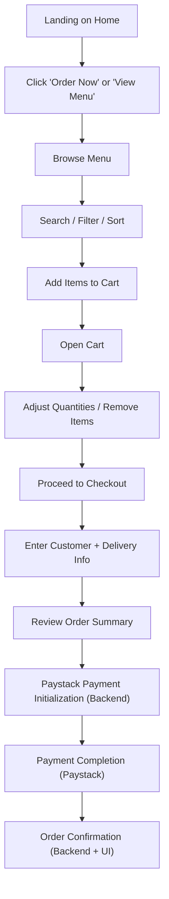

## 1. Product Overview
Nana’s Akara is a premium Nigerian online food ordering platform that enables customers to discover authentic meals, place orders quickly, and pay securely for doorstep delivery.
- Purpose: Increase conversion via a fast, trustworthy, mobile-first ordering experience
- Target users: Lagos/Nigeria customers ordering breakfast/lunch/dinner for home/office delivery
- Value: Premium brand presentation + frictionless ordering + secure online payment readiness

## 2. Core Features

### 2.1 User Roles
- Customer (primary): browse menu, search/filter, add to cart, checkout, pay
- Admin (future, not in this frontend): manage menu, orders, content, pricing

### 2.2 Feature Modules (Pages)
1. **Home (index.html)**: premium hero, best sellers, trust sections, testimonials, newsletter, CTA
2. **Menu (menu.html)**: full catalog, category filters, search, sorting, add-to-cart, quantity selector
3. **Cart (cart.html)**: editable cart, pricing summary, proceed to checkout
4. **Checkout (checkout.html)**: customer/delivery info, order summary, Paystack-ready payment CTA
5. **Careers (careers.html)**: culture/benefits, open roles, application form + CV upload UI
6. **Contact (contact.html)**: contact form, support info, FAQs, social links, map placeholder

### 2.3 Cross-cutting Modules (Global)
- Sticky header + responsive nav + mobile drawer menu
- Cart icon with live item count across all pages
- WhatsApp floating support button (pre-filled message)
- Live chat widget placeholder (UI + toggling, no external service yet)
- Premium footer: quick links, support, newsletter signup, socials
- SEO: unique titles/descriptions, OG/Twitter, JSON-LD, sitemap.xml, robots.txt
- Accessibility: semantic structure, keyboard navigation, ARIA labels, focus management, form semantics
- Performance: minimal JS, responsive images, preconnect fonts, critical CSS organization

### 2.4 Functional Requirements (Key Behaviors)
- **Menu data**: realistic sample dataset in `js/data.js` with categories, prices, descriptions, and image URLs/paths
- **Cart system**:
  - Add items from Home and Menu
  - Update quantity in Cart and Menu quantity selector
  - Remove items
  - Persist cart state in `localStorage`
  - Compute subtotal + delivery fee placeholder + total
- **Search & filtering**:
  - Search by name/description
  - Filter by category
  - Sort by featured/default, price low→high, price high→low, name A→Z
- **Forms**:
  - Contact: client-side validation + API submission abstraction
  - Careers: validation + file upload UI (front-end only) + API abstraction
  - Newsletter: lightweight UI feedback + API abstraction
- **Checkout**:
  - Validate customer + delivery info
  - Render order summary with totals
  - “Pay Securely with Paystack” button triggers a function that sends order payload to a future backend endpoint for Paystack initialization

## 3. Core Process
Primary user flow: customer browses → adds to cart → reviews cart → completes checkout → payment initialization → confirmation messaging (future backend).

## 4. User Interface Design

### 4.1 Design Style
- Brand colors:
  - Primary: Teal (#0F766E)
  - Secondary: White (#FFFFFF)
  - Accent: Light Gray (#F8FAFC)
  - Text: Dark Charcoal (#0F172A)
- Typography:
  - Premium pairing: refined display font for headings + modern sans-serif for body (self-hosted or Google Fonts, with `font-display: swap`)
  - Headings: bold, tight leading, generous tracking for luxury feel
  - Body: high legibility, large default size on mobile (16–18px)
- Layout:
  - Minimalist grid, spacious sections, high-quality imagery
  - Cards with subtle borders and soft shadow; strong hover and focus states
  - Strong primary CTA, consistent across pages
- Motion:
  - Hero reveal: staged entrance for headline/subheadline/CTAs
  - Scroll fade/slide animations (AOS optional)
  - Micro-interactions: button press states, card hover lift, cart count pulse
- Icon style:
  - Lucide icons preferred (consistent line icon style) or Font Awesome

### 4.2 Page Design Overview
| Page Name | Module Name | UI Elements |
|-----------|-------------|-------------|
| Home | Hero | Full-width hero image, headline/subheadline, dual CTAs, trust badges |
| Home | Best Sellers | 6-item grid cards, price + add to cart, quick feedback toast |
| Home | About | Split layout, brand story, ingredient/heritage emphasis |
| Home | Why Choose Us | 4 feature tiles with icons |
| Home | Testimonials | Slider/cards with star ratings |
| Home | Newsletter | Email input + submit microcopy |
| Menu | Filters | Category pills, search bar, sort dropdown |
| Menu | Catalog | Responsive grid, quantity selector, add to cart |
| Cart | Cart Table | Item list, quantity stepper, remove, totals summary |
| Checkout | Form + Summary | Two-column on desktop, stacked on mobile, Paystack CTA |
| Careers | Culture + Roles | Benefits cards, open roles list, application form |
| Contact | Support + FAQ | Contact form, quick support blocks, FAQ accordion, map placeholder |

### 4.3 Responsiveness
- Mobile-first, progressively enhanced for tablet/desktop
- Touch-friendly targets (minimum 44px)
- Sticky header with compact layout on scroll
- Menu filters collapse into a tidy toolbar on small screens
- Cart/checkout layouts switch from stacked (mobile) to split columns (desktop)

## 5. Content & Data Requirements
- Realistic Nigerian menu items with:
  - Name, short description, long description (optional), category, price (₦), bestseller flag, tags (e.g., spicy, vegetarian-friendly)
  - Image: premium food photo URLs generated via a reliable image endpoint during development; swappable to CDN/local assets later
- Testimonials: 6–10 realistic reviews with ratings (4–5 stars) and first name + area (e.g., “Ikeja”)
- FAQ: delivery time, payment, freshness, dietary options, order changes

## 6. Non-Functional Requirements
- Performance: minimal dependencies; defer non-critical scripts; lazy-load non-hero images
- Accessibility: WCAG-aligned contrast, clear focus rings, semantic landmarks, labelled controls, aria-live for cart feedback
- SEO: each page unique meta, structured data (Restaurant schema), sitemap.xml + robots.txt preparation
- Security (front-end): never store sensitive payment data; only handle Paystack redirect/initialization references from backend later
