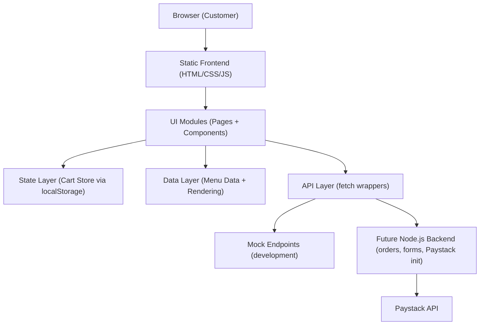

## 1. Architecture Design



## 2. Technology Description
- Frontend:
  - HTML5 semantic pages
  - CSS3 (variables, responsive layout, component-driven organization)
  - Vanilla JavaScript (ES6 modules)
- Optional external libraries (CDN, progressively enhanced):
  - AOS (scroll animations)
  - Swiper.js (testimonials slider)
  - Lucide icons or Font Awesome (icons)
- Build tooling:
  - None required for first release (static hosting ready)
  - Structure is compatible with later bundling (Vite/Webpack) without rewrites

## 3. Project Structure
The frontend is a multi-page, modular ES6 setup designed for future backend integration.

```
frontend/
  index.html
  menu.html
  careers.html
  contact.html
  cart.html
  checkout.html
  assets/
    images/
    icons/
  css/
    variables.css
    reset.css
    global.css
    components.css
    responsive.css
  js/
    data.js
    api.js
    cart.js
    menu.js
    checkout.js
    search.js
    chat.js
    main.js
  sitemap.xml
  robots.txt
```

## 4. Route Definitions
| Route (File) | Purpose |
|-------------|---------|
| /index.html | Premium landing page and featured best sellers |
| /menu.html | Full catalog with filters, search, sorting |
| /cart.html | Cart review and edits |
| /checkout.html | Checkout form + order summary + Paystack init trigger |
| /careers.html | Hiring info + application form |
| /contact.html | Contact form + FAQs + map placeholder |

## 5. Frontend Module Responsibilities
- `js/main.js`
  - Initialize shared UI: header behavior, mobile nav, cart count, newsletter UI, footer interactions
  - Register global event listeners (delegated where possible)
- `js/data.js`
  - Export menu dataset, categories, testimonials
  - Keep data format stable for backend swap later
- `js/cart.js`
  - Single source of truth for cart operations
  - `localStorage` persistence, totals computation, cart count
  - Emit custom events (e.g., `cart:updated`) for UI synchronization
- `js/menu.js`
  - Render menu catalog
  - Bind filtering/search/sort UI
  - Add-to-cart interactions + quantity controls
- `js/search.js`
  - Pure helpers for searching/filtering/sorting datasets
- `js/checkout.js`
  - Form validation, order payload assembly, render order summary
  - Trigger `api.initializePaystackPayment(payload)` (stubbed until backend exists)
- `js/api.js`
  - `fetch` wrapper with timeouts, JSON parsing, consistent error handling
  - Mock endpoints by default; switchable base URL for Node.js backend later
- `js/chat.js`
  - Live chat placeholder widget: open/close UI, basic message list in memory only

## 6. Data Contracts (Frontend)

### 6.1 Menu Item Shape
```js
{
  id: "akara-pap-combo",
  name: "Akara & Pap Combo",
  description: "Hot, crispy akara served with smooth pap and milk.",
  category: "Breakfast Combos",
  price: 3200,
  image: "https://.../text_to_image?...",
  badges: ["Bestseller"],
  tags: ["breakfast"]
}
```

### 6.2 Cart Item Shape
```js
{
  id: "akara-pap-combo",
  qty: 2,
  unitPrice: 3200
}
```

### 6.3 Order Payload (for backend later)
```js
{
  customer: { fullName, email, phone },
  delivery: { address, city, state, notes },
  items: [{ id, name, qty, unitPrice, lineTotal }],
  amounts: { subtotal, deliveryFee, total },
  currency: "NGN",
  metadata: { source: "web", createdAt }
}
```

## 7. API Definitions (Mock-first, Backend-ready)
All API functions return a normalized shape:
- Success: `{ ok: true, data }`
- Failure: `{ ok: false, error: { message, code? } }`

### 7.1 Endpoints (Future)
| Function | Method | Path | Purpose |
|----------|--------|------|---------|
| fetchMenuItems | GET | /api/menu | Fetch menu items |
| submitContactForm | POST | /api/contact | Submit contact message |
| submitCareerApplication | POST | /api/careers/apply | Submit application (multipart) |
| createOrder | POST | /api/orders | Create order record |
| initializePaystackPayment | POST | /api/payments/paystack/initialize | Initialize Paystack transaction |

## 8. SEO & Metadata Plan
- Unique `<title>` and meta description per page
- Open Graph + Twitter card tags per page
- JSON-LD:
  - Restaurant schema on Home
  - WebSite schema + SearchAction (optional) if search is promoted
- `sitemap.xml` includes all HTML routes
- `robots.txt` prepared (allow indexing, point to sitemap)

## 9. Accessibility Plan
- Semantic landmarks: `header`, `nav`, `main`, `footer`
- Skip-to-content link on every page
- Form inputs:
  - `label` + `for` for every control
  - clear error states with aria-describedby
  - aria-live region for validation summaries where needed
- Keyboard support:
  - Mobile nav trap/focus return
  - Cart quantity steppers accessible via buttons
- Reduced motion:
  - Respect `prefers-reduced-motion` to disable non-essential animations

## 10. Performance Plan
- Preload key font files (if self-hosted) and hero image
- Lazy-load non-critical images (`loading="lazy"`)
- Use responsive `srcset` (optional) and set width/height to prevent layout shifts
- Minimize DOM work via event delegation and fragment rendering
